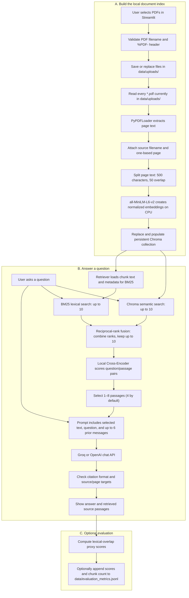

# ShryAI: Detailed Project and Technology Workflow

> **Historical document:** This guide describes the original Streamlit
> prototype. The current authenticated Django/DRF implementation is documented
> in [README.md](./README.md); do not use this guide as a description of the
> current security or deployment behavior.

## 1. What the project does

ShryAI is a local-first PDF question-answering application built with Python
and Streamlit. It turns searchable PDF pages into small indexed text passages,
finds passages that may answer a user's question, and asks a configured
language-model provider to write an answer grounded in those passages.

This architecture is called **Retrieval-Augmented Generation (RAG)**:

- **Retrieval** finds relevant material in the user's own document collection.
- **Augmentation** supplies that material as context to the language model.
- **Generation** uses the model to phrase an answer, with source and page
  citations.

The model does not search the PDFs itself. ShryAI performs extraction,
indexing, and retrieval first, then sends the question and selected excerpts
to the configured Groq or OpenAI API. The full PDF is not sent by this
application.

## 2. Technologies and their roles

| Technology | What it does in this project |
|---|---|
| Python | Runs the application and its ingestion, retrieval, generation, and evaluation logic. |
| Streamlit | Provides the browser-based upload, indexing, chat, source-reference, and evaluation interface in one application process. |
| `python-dotenv` | Loads provider settings and API keys from the local `.env` file. |
| LangChain `PyPDFLoader` / `pypdf` | Reads searchable text from PDF pages and supplies page-level documents. It does not OCR image-only pages. |
| LangChain `RecursiveCharacterTextSplitter` | Splits extracted page text into chunks of 500 characters with 50 characters of overlap. |
| Sentence-Transformers `sentence-transformers/all-MiniLM-L6-v2` | Converts each chunk and each semantic-search question into a normalized numeric embedding. It is configured to run on the CPU. |
| ChromaDB via LangChain | Stores chunk text, metadata, and embeddings persistently in `vector_store/`; it supports nearest-neighbor semantic search. |
| `rank_bm25` / `BM25Okapi` | Finds passages with overlapping query terms, complementing semantic search. Its corpus is built in memory from indexed chunks when the retriever is initialized. |
| Sentence-Transformers Cross-Encoder (`cross-encoder/ms-marco-MiniLM-L-6-v2` by default) | Reads each question/passage pair and scores its relevance for a final reranking step. It runs locally. |
| LangChain `ChatGroq` or `ChatOpenAI` | Sends the question, selected passage context, and limited conversation history to the configured remote answer-generation model. |
| Local Python evaluation functions | Calculate lexical-overlap proxy scores and optionally append aggregate metrics to a JSON Lines file. The current UI does not run RAGAS. |

The embedding and reranker model files may need to be downloaded the first
time they are used. Model inference for embeddings and reranking is local;
answer generation is a network call to the selected provider.

## 3. End-to-end workflow

### A. Upload and index PDFs

1. The user chooses one or more PDFs using the Streamlit sidebar. On the
   **Build / refresh index** action, the application checks that each
   sanitized filename still has a `.pdf` extension and that the content begins
   with the PDF signature `%PDF-`.
2. Files are written to `data/uploads/`. A file with the same sanitized name
   replaces the existing staged file of that name.
3. Indexing processes **all** PDF files in `data/uploads/`, not just the files
   selected in that particular upload action. Uploading alone does not update
   the index; the user must build or refresh it.
4. `PyPDFLoader` extracts text page by page. The loader's zero-based page
   metadata is converted to a one-based page number, and each page is tagged
   with its source filename.
5. `RecursiveCharacterTextSplitter` makes chunks of up to 500 characters with
   a 50-character overlap. The overlap helps preserve context when a relevant
   passage falls across a chunk boundary. Each chunk retains its source and
   page metadata.
6. The Hugging Face `all-MiniLM-L6-v2` embedding model turns each chunk into a
   normalized vector on the CPU. Chroma stores these vectors alongside the
   chunk text and metadata in `vector_store/`.
7. A refresh replaces the collection with chunks from the PDFs staged at that
   time. To remove a document, delete its PDF from `data/uploads/` and rebuild.

An empty-text PDF is rejected with an explanatory error. Pages with no
extractable text are logged and skipped by the splitter. Scanned or
image-only PDFs need to be OCR-processed into searchable PDFs before upload;
OCR is not part of this application.

### B. Retrieve evidence for a question

When a question is submitted, the app reads the index count. If the index is
empty, it returns the fixed evidence-not-found response without calling an
answer model. Otherwise, it performs two complementary searches:

1. **Semantic search:** Chroma embeds the question and finds up to 10 chunks
   with nearby vectors. This can find conceptually similar wording even when
   the wording is not identical.
2. **Lexical search:** BM25 ranks indexed chunk text by query-token matches.
   This can help with exact names, terms, and phrases. The retriever loads the
   indexed chunk text and metadata into memory when it is initialized to build
   this BM25 corpus.
3. **Reciprocal-rank fusion (RRF):** the two ranked lists are combined using
   `1 / (60 + rank)` for each occurrence. A chunk appearing highly in both
   lists receives contributions from both. The implementation deduplicates
   by source, page, and chunk text, then retains up to 10 candidates.
4. **Cross-Encoder reranking:** a local Cross-Encoder scores each candidate
   together with the full question as a pair. This pairwise relevance step
   reorders the candidates after the first-stage searches.
5. **Evidence selection:** the highest-ranked 1–8 passages are selected for
   the answer prompt. The UI defaults to 4. This setting changes how many
   passages are sent to the generator, not the initial candidate limit.

The semantic and lexical searches are not interchangeable: embeddings are
useful for meaning, while BM25 rewards shared terms. Combining them and then
reranking is intended to make the final evidence set more useful than relying
on either first-stage search alone.

### C. Generate and validate the answer

The prompt sent to the selected chat model contains:

- The user's current question.
- Retrieved context blocks, each labeled with source filename and page.
- Up to the last six prior chat messages, marked as conversation history only,
  not evidence.
- Instructions to answer only from the retrieved context, cite factual claims
  in the form `[source filename, p. N]`, and use the fixed fallback when the
  context does not answer the question.

The provider is selected with `SHRYAI_LLM_PROVIDER` (`groq` by default or
`openai`); the corresponding API key and optional model name come from `.env`.
The provider receives the question, retrieved excerpts, and recent chat
history. The app does not send the whole PDF as part of this request.

After generation, ShryAI requires at least one citation and verifies that each
cited source filename and page pair occurs among the retrieved passages. If
there are no citations or any citation points elsewhere, the application
returns the fixed fallback instead of the generated text.

This validation checks citation presence and targets; it does **not** establish
that each sentence is entailed by the cited passage, detect every
hallucination, or prove that retrieval found all relevant evidence. The UI
shows retrieved source passages so a person can inspect the supporting text.

### D. Evaluate a response

The Evaluation tab operates on the most recent response and its retrieved
passages. It computes two local, word-overlap proxies after tokenization and
stop-word removal:

- **Faithfulness proxy:** for each non-empty answer sentence, the fraction of
  its content words found somewhere in the retrieved context; then the mean
  across sentences.
- **Answer relevance proxy:** the fraction of the question's content words
  found in the answer.

These are transparent heuristics, not semantic entailment tests and not the
canonical RAGAS Faithfulness or Answer Relevance metrics. Although `ragas`
appears in the dependency list, the current application does not call it.
When the user evaluates a response, the app appends a UTC timestamp, the two
scores, and retrieved chunk count to `data/evaluation_metrics.jsonl`. It does
not put the question, answer, or passage text into that log.

## 4. Runtime and data boundaries

The application runs as a single Streamlit process. It does not have a
separate backend API or frontend service.

| Data or operation | Where it happens |
|---|---|
| PDF uploads | Stored locally in `data/uploads/`. |
| Extracted text, chunking, and embeddings | Processed on the machine running ShryAI. |
| Persistent chunk index | Stored locally in `vector_store/`. |
| BM25 corpus | Loaded into the retriever's process memory from the index. |
| Cross-Encoder inference | Runs locally on the machine. |
| Generated answer | Uses the configured Groq or OpenAI API over the network. |
| Evaluation log | Local `data/evaluation_metrics.jsonl`, containing metric values and count only. |
| Provider credentials | Read from the local `.env`; do not commit or share real keys. |

Because retrieved text and recent conversation messages are sent to the
selected answer provider, users should check that provider's data-handling
terms and only use documents they are authorized to process.

## 5. Configuration that affects the workflow

- `SHRYAI_LLM_PROVIDER`: `groq` or `openai` (default: `groq`).
- `GROQ_API_KEY` / `OPENAI_API_KEY`: required key for the selected provider.
- `GROQ_MODEL` / `OPENAI_MODEL`: optional provider model identifier.
- `SHRYAI_RERANKER_MODEL`: optional local Cross-Encoder model identifier.
- The embedding model is currently fixed in source as
  `sentence-transformers/all-MiniLM-L6-v2`.
- Chunk size and overlap are currently source defaults: 500 and 50
  characters.
- Generation temperature is set in the sidebar; retrieved passage count is
  adjustable from 1 to 8, defaulting to 4.

## 6. Important limitations

- There is no OCR pipeline, user authentication, authorization, or
  document-level access control.
- The application is a local demonstration, not a multi-user enterprise
  service.
- Citation checks validate references, not factual support or completeness.
- Retrieval quality depends on PDF text quality, chunk boundaries, the chosen
  models, and the question. A relevant passage can be missed.
- The evaluation values are lexical proxies and must not be interpreted as
  proof that an answer is correct.
- For important or compliance-sensitive decisions, inspect the source
  passages and apply the appropriate human review process.

## 7. Source code map

- [`app.py`](./app.py): Streamlit UI and orchestration of upload, indexing,
  chat, source display, and evaluation.
- [`src/ingestion.py`](./src/ingestion.py): PDF loading, page metadata,
  splitting, embeddings, Chroma persistence, and index statistics.
- [`src/retriever.py`](./src/retriever.py): semantic and BM25 search, RRF, and
  Cross-Encoder reranking.
- [`src/generator.py`](./src/generator.py): Groq/OpenAI configuration, prompt
  construction, answer generation, and citation checks.
- [`src/evaluation.py`](./src/evaluation.py): lexical proxy metrics and
  privacy-conscious JSONL logging.
- [`requirements.txt`](./requirements.txt): pinned Python dependencies.
